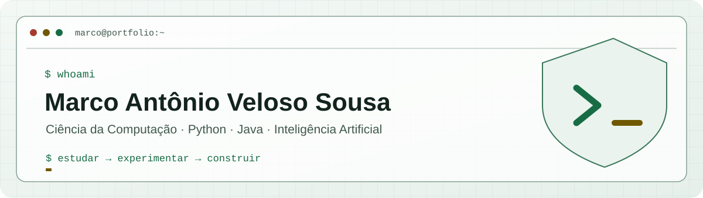
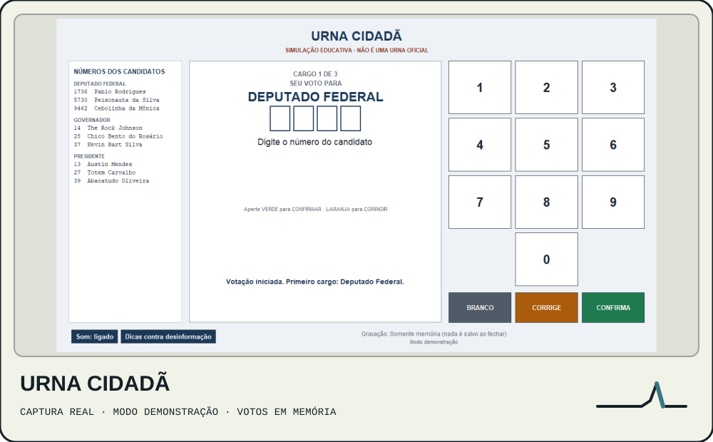
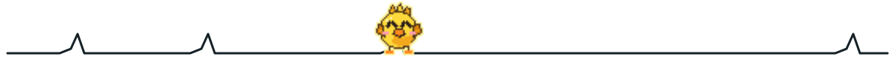

  <picture>
    <source media="(prefers-color-scheme: dark)" srcset="assets/profile-banner.svg" />
    <source media="(prefers-color-scheme: light)" srcset="assets/profile-banner-light.svg" />
    
  </picture>

  <strong>Estudante de Ciência da Computação · Python e Java · Engenharia de IA e Machine Learning</strong> 
  Unijorge · conclusão prevista para 2028 · Salvador, BA 
  LinkedIn: adicionar URL · <a href="mailto:marcoantoniq7162@gmail.com">E-mail</a>

<picture>
  <source media="(prefers-color-scheme: dark)" srcset="assets/section-divider-dark.svg" />
  <source media="(prefers-color-scheme: light)" srcset="assets/section-divider-light.svg" />
  
</picture>

## Construindo agora

Desenvolvo projetos acadêmicos e pessoais que conectam fundamentos de software a experimentos de IA. No Synapse Pet exploro uma rede neural pulsada em NumPy; na Urna Cidadã construo, em equipe, um simulador educativo em Java.

<picture>
  <source media="(prefers-color-scheme: dark)" srcset="assets/section-divider-dark.svg" />
  <source media="(prefers-color-scheme: light)" srcset="assets/section-divider-light.svg" />
  
</picture>

## Estudando agora

Engenharia de IA e fundamentos de Machine Learning, com atenção à avaliação dos experimentos e à integração em aplicações de software.

## Projetos em destaque

<table>
  <tr>
    <td width="50%" valign="top">
      
<a href="https://github.com/Sudo-Marco/synapse-companion"><picture>
        <source media="(prefers-color-scheme: dark)" srcset="assets/card-synapse-dark.svg" />
        <source media="(prefers-color-scheme: light)" srcset="assets/card-synapse-light.svg" />
        
      </picture></a>

      
Companion desktop local com SNN em NumPy (LIF e STDP modulada por recompensa), política contextual e interface em PySide6. As avaliações sintéticas e limitações estão documentadas.

      
<picture>
        <source media="(prefers-color-scheme: dark)" srcset="assets/stack-synapse-dark.svg" />
        <source media="(prefers-color-scheme: light)" srcset="assets/stack-synapse-light.svg" />
      
      </picture>

      
<a href="https://github.com/Sudo-Marco/synapse-companion">Ver código e documentação</a>

    </td>
    <td width="50%" valign="top">
      
<a href="https://github.com/Sudo-Marco/urna-cidada"><picture>
        <source media="(prefers-color-scheme: dark)" srcset="assets/card-urna-dark.svg" />
        <source media="(prefers-color-scheme: light)" srcset="assets/card-urna-light.svg" />
        
      </picture></a>

      
Simulador educativo de votação em Java 17 e Swing, feito em equipe, com persistência local e sincronização opcional com Cloud Firestore.

      
<picture>
        <source media="(prefers-color-scheme: dark)" srcset="assets/stack-urna-dark.svg" />
        <source media="(prefers-color-scheme: light)" srcset="assets/stack-urna-light.svg" />
        
      </picture>

      
<a href="https://github.com/Sudo-Marco/urna-cidada">Ver código e documentação</a>

    </td>
  </tr>
</table>

<picture>
  <source media="(prefers-color-scheme: dark)" srcset="assets/section-divider-spike-dark.svg" />
  <source media="(prefers-color-scheme: light)" srcset="assets/section-divider-spike-light.svg" />
  
</picture>

<code>sudo construir --com-curiosidade</code> 
  LinkedIn: adicionar URL · <a href="mailto:marcoantoniq7162@gmail.com">E-mail</a> · <a href="https://github.com/Sudo-Marco">GitHub</a>

