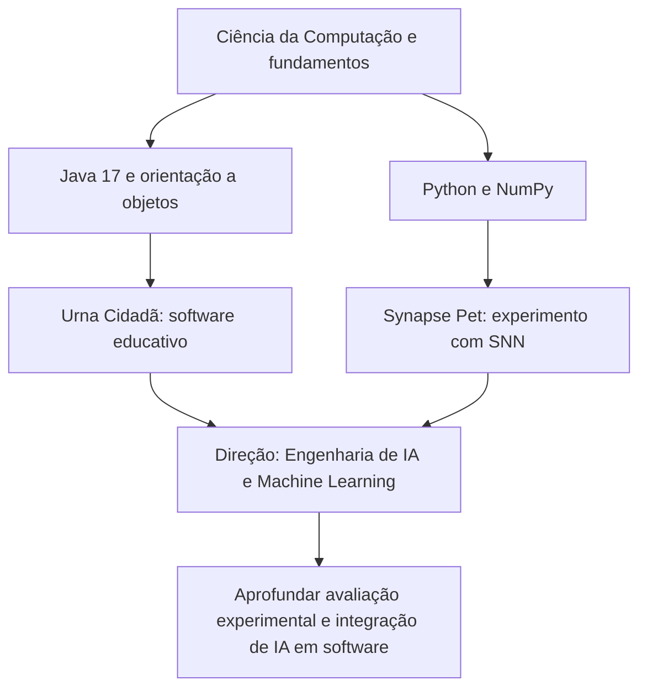

  

  <strong>Estudante de Ciência da Computação na Unijorge</strong> 
  Desenvolvimento de software · Python · Java · experimentos de IA

## Sobre

Curso Ciência da Computação e gosto de transformar conceitos em projetos que possam ser executados, observados e explicados. Tenho explorado desenvolvimento de software e inteligência artificial em projetos pessoais e acadêmicos.

Meu foco atual é fortalecer os fundamentos de engenharia de IA e aprendizado de máquina, conectando experimentação, avaliação e software útil.

## Projetos em destaque

### [Synapse Pet](https://github.com/Sudo-Marco/synapse-companion)

Experimento local para desktop com uma pequena rede neural pulsada implementada em NumPy. Explora neurônios LIF, STDP modulada por recompensa e traços de elegibilidade, combinados com preferências por contexto. A interface é feita em PySide6 e o repositório documenta avaliações sintéticas e limitações do experimento.

**Tecnologias:** Python · NumPy · PySide6

### [Urna Cidadã](https://github.com/Sudo-Marco/urna-cidada)

Projeto acadêmico em equipe sobre cidadania digital e desinformação eleitoral. É um simulador educativo de votação em Java 17 e Swing, com persistência local e sincronização opcional com Cloud Firestore. O repositório inclui testes automatizados e documentação de uso e implementação.

**Tecnologias:** Java 17 · Swing · Cloud Firestore

## Minha trilha

## Tecnologias em prática

| Área | Aplicação nos projetos |
| --- | --- |
| Python e NumPy | Experimentos com redes neurais pulsadas e avaliações sintéticas |
| PySide6 | Interface desktop do Synapse Pet |
| Java 17 e Swing | Programação orientada a objetos e interface do Urna Cidadã |
| Persistência | Armazenamento local e integração opcional com Cloud Firestore |
| Git e GitHub | Versionamento, documentação e publicação dos projetos |

**Conhecimentos complementares:** PostgreSQL · pgAdmin · Visual Studio Code

## Formação

- **Bacharelado em Ciência da Computação — Unijorge** · agosto de 2025 – agosto de 2028 (previsão)
- **Hackers do Bem** · Nivelamento (80h) e Básico (64h)
- **Inglês** · básico a intermediário

## Experiência prática adicional

Vivência com suporte técnico e diagnóstico de equipamentos, incluindo impressoras, periféricos, pontos de venda, pinpads, redes e portas seriais.

---

Os projetos fixados abaixo mostram o código e a documentação. A atividade e o histórico de contribuições também podem ser consultados no próprio perfil.
